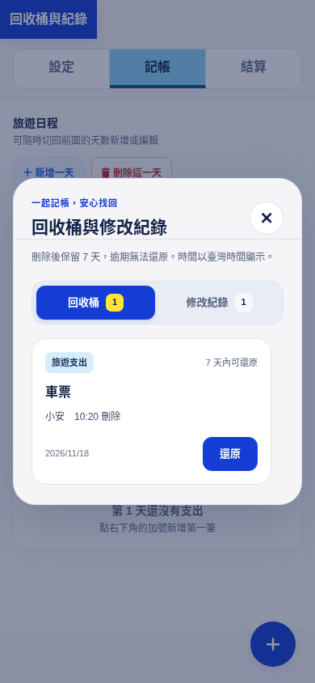
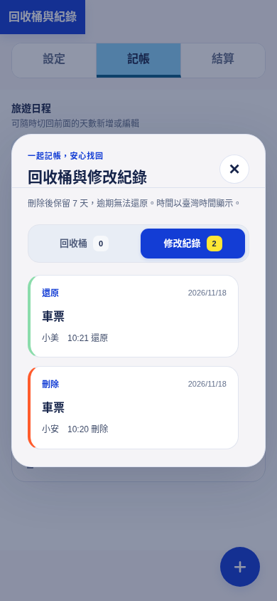
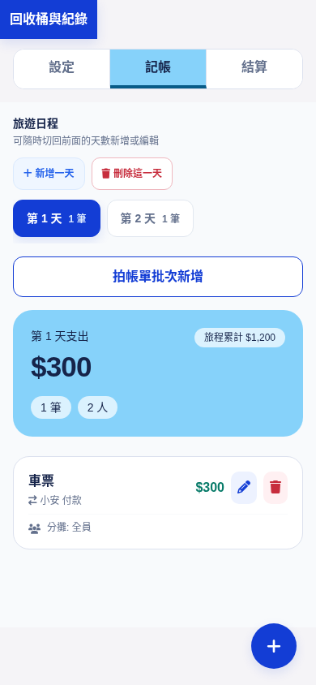
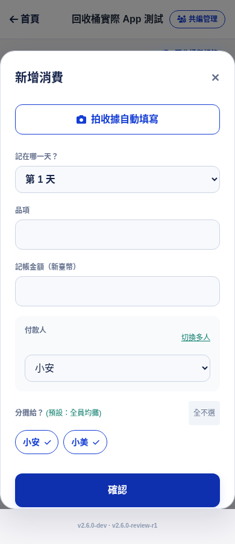

# 回收桶與修改紀錄測試畫面

這些是正式 React 元件與 handlers、搭配記憶體 Firebase 替身的瀏覽器畫面，帳目全為虛構測試資料。此分支尚未發布至正式網站。

| 畫面 | 預覽 |
| --- | --- |
| 單筆回收桶 |  |
| 刪除與還原紀錄 |  |
| 刪除中間日後的日序 |  |
| 新增支出的有效天數選單 |  |

測試輸出：

- [15 個 handler 整合情境](handler-integration-results.json)
- [9 個完整 App 回歸情境](app-regression-results.json)
- [32 個回收桶元件檢查](recovery-panel-results.json)
- [6 個開場計時情境](splash-results.json)
- [手機日期欄界線與 picker](date-field-results.json)

完整範圍與限制見 [驗證紀錄](../../VERIFICATION_v2.6.0.md)。
